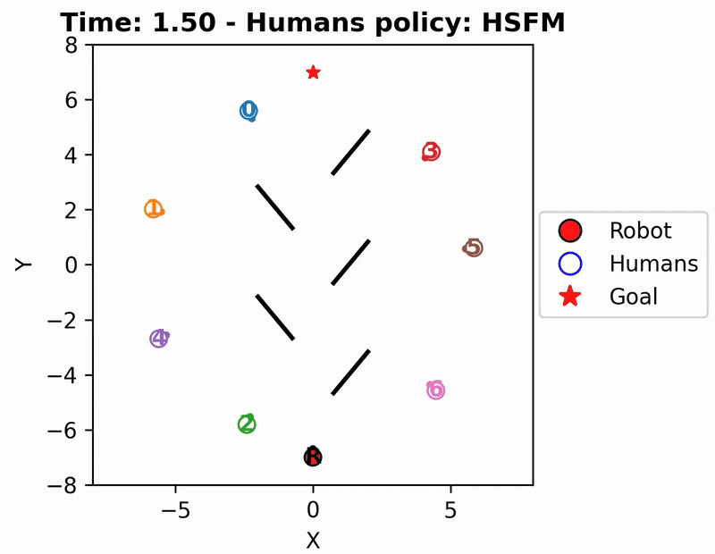
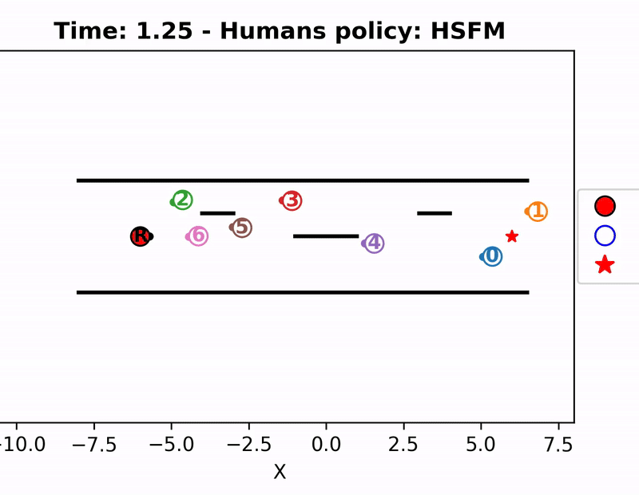
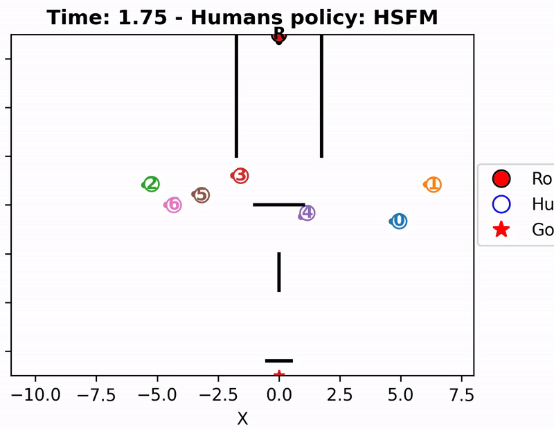
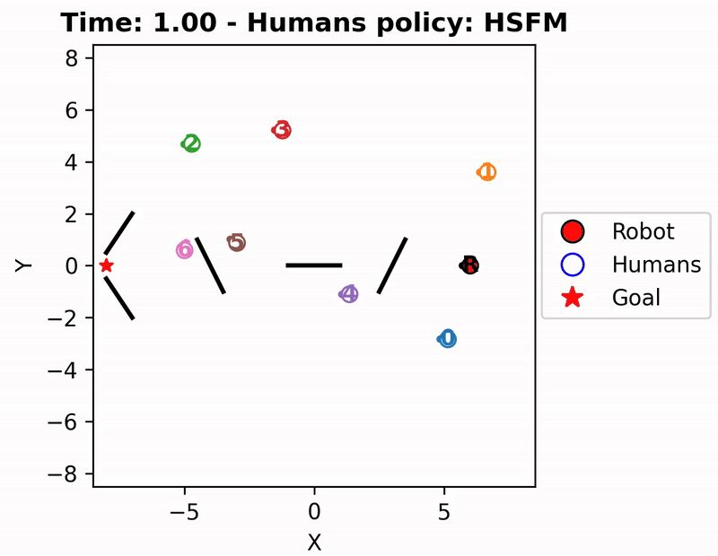
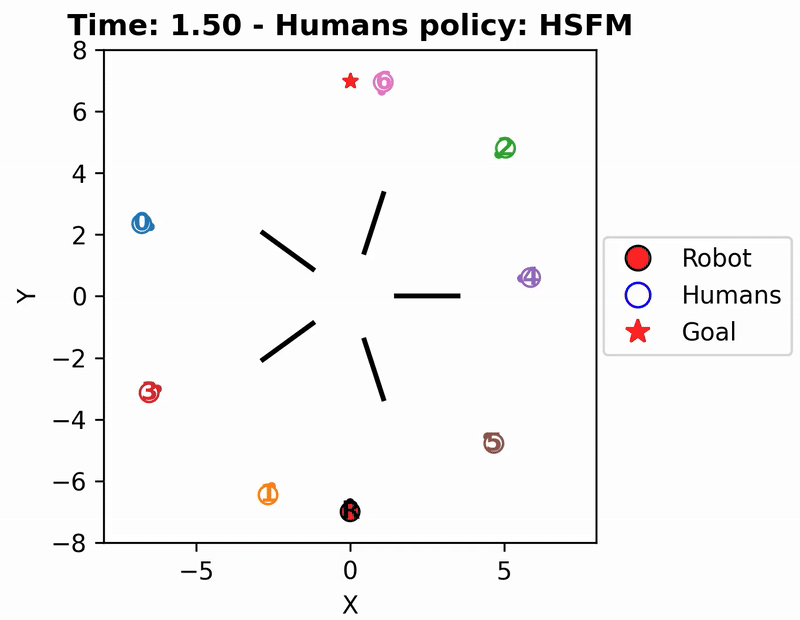
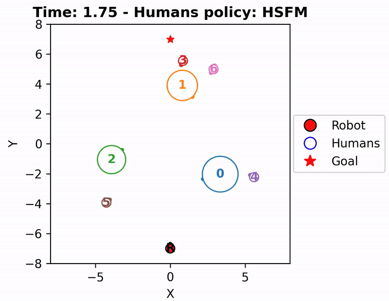
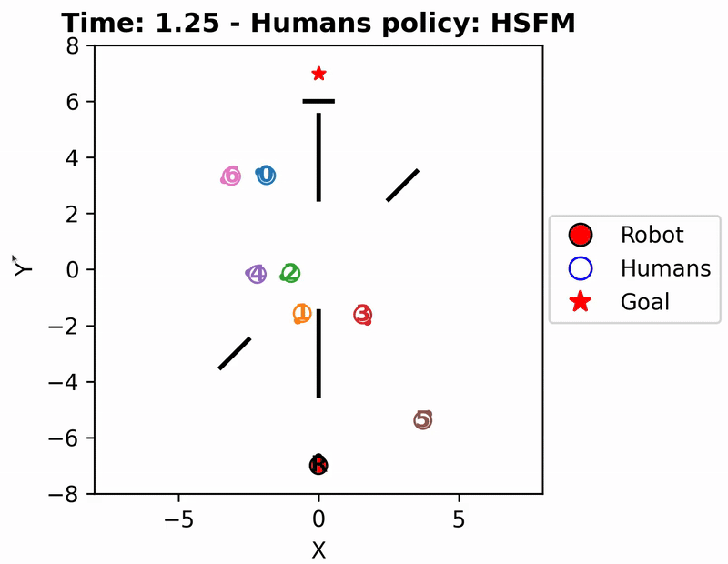
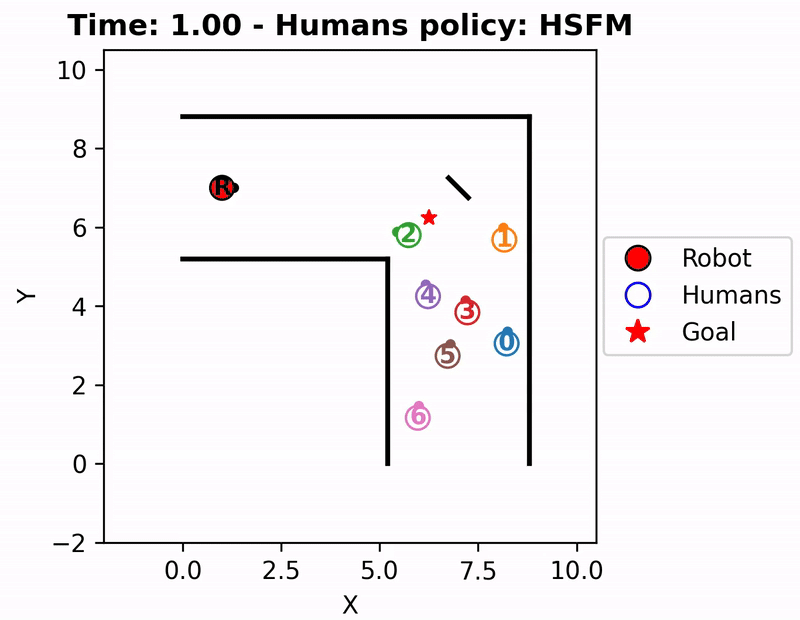

# social-jym
An environment based on JAX to train mobile robots within crowded environments. Includes several human motion models, several RL algorithms for social navigation and implements fast training and computing thanks to JAX.

[](https://arxiv.org/abs/XXXX.XXXXX)
[](https://arxiv.org/abs/YYYY.YYYYY)
[](https://github.com/TommasoVandermeer/social-jym/tree/dir-safe)
[](https://github.com/TommasoVandermeer/social-jym/tree/jessi)

>  **Research Contributions**
>
> This repository hosts the official implementation of our work on mobile robot navigation in dense crowds:
> 
> 1. **"Safe Robot Navigation with Reinforcement Learning using Dirichlet Distributions and Social Attention"**  
>    *Published at IEEE ICAR 2025* — [[Paper]](https://doi.org/10.1109/ICAR65334.2025.11338678) | 📌 **[Code: DIR-SAFE branch](https://github.com/TommasoVandermeer/social-jym/tree/dir-saf)**
>
> 2. **"End-to-End Safe Social Navigation via Multi-Task Reinforcement Learning and Probabilistic Perception"**  
>    *Presented at IEEE/RSJ IROS 2026* — [[Paper]](https://doi.org/10.48550/arXiv.2610.05733) | 📌 **[Code: JESSI branch](https://github.com/TommasoVandermeer/social-jym/tree/jessi)**

## Installation

### Option 1: Virtual environment (tested on Ubuntu 22.04 with Python 3.10 and Debian 13 with Python 3.13)

Create a virtual environment.
```
virtualenv socialjym
```
Activate the virtual environment.
```
source socialjym/bin/activate
```
Clone the repository and its submodules.
```
git clone --recurse-submodules https://github.com/TommasoVandermeer/social-jym.git
```
Install the submodules and the main package.
```
pip install -e social-jym social-jym/JHSFM social-jym/JSFM social-jym/JORCA
```
Instead, if you want to run JAX on your GPU (with CUDA12) run:
```
pip install -e social-jym[cuda12] social-jym/JHSFM social-jym/JSFM social-jym/JORCA
```

### Option 2: Docker (Ubuntu 22.04, Python 3.10)

Clone the repository and its submodules.
```
git clone --recurse-submodules https://github.com/TommasoVandermeer/social-jym.git
```
Navigate to the repository root. Build and run the container using the provided script (it will build the image automatically on first run if not already present):
```
cd social-jym
```

**CPU-only:**
```
./docker/run.sh
```

**With NVIDIA GPU** (requires [nvidia-container-toolkit](https://docs.nvidia.com/datacenter/cloud-native/container-toolkit/latest/install-guide.html) on the host):
```
./docker/run.sh --gpu
```

To force a rebuild of the image (e.g. after updating dependencies):
```
./docker/run.sh --build
./docker/run.sh --gpu --build
```

**On machines with NFS home directories** (e.g. network-mounted `/home`), Docker may lack permission to bind-mount the repository. Use `--no-mount` in that case:
```
./docker/run.sh --no-mount
./docker/run.sh --gpu --no-mount
```
With `--no-mount` the container uses the code baked into the image at build time. To sync modified files from the host into a running container without rebuilding, use `docker cp` from a separate terminal:

```
docker cp socialjym/ social-jym:/opt/social-jym/socialjym
```

The container is always named `social-jym`, so this works as long as it is running.

The container supports GUI forwarding (matplotlib windows, notebooks, etc.) via the host X11 server and, when not using `--no-mount`, mounts the repository root at `/opt/social-jym` so code changes are reflected immediately without rebuilding the image.

## Project structure
The source code of the project can be found in the folder socialjym which includes all the python modules. 

### Envs ([envs readme](socialjym/envs/README.md))
Includes all the available Reinforcement Learning environments developed in an open AI gymnasium style (step, reset, _get_obs, ecc..) but with functional programming (required for JAX). BaseEnv serves as a base class defining the methods and attributes each environment should have. In BaseEnv also the available scenarios, human motion models and robot kinematic models are listed. [SocialNav](socialjym/envs/README.md) and [LaserEnv](socialjym/envs/README.md) are complete environments that can be used to train and test RL policies for navigation (click on the links to see more). 

<b>Human motion models</b>
- ORCA (Optimal Reciprocal Collision Avoidance) [[1]](#orca).
- SFM (Social Force Model) [[2]](#sfm).
- HSFM (Headed Social Force Model)  [[3]](#hsfm).

<b>Scenarios</b> [[4]](#soc-guidelines)

| Scenario | Scenario |
| :---: | :---: |
| **CC: Circular Crossing**<br> | **PaT: Parallel Traffic**<br> |
| **PeT: Perpendicular Traffic**<br> | **RC: Robot Crowding**<br> |
| **DCC: Delayed Circular Crossing**<br> | **CCSO: Circular Crossing with Static Obstacles**<br> |
| **CN: Crowd Navigation**<br> | **CT: Corner Traffic**<br> |

<b>Robot kinematic models</b>
- Holonomic
- Differential Drive

### Policies
Includes all the available Reinforcement Learning policies that can be used in the environments. BasePolicy serves as a base class defining the abstract methods each policy should have. Here is a comprehensive list:
- CADRL [[5]](#cadrl).
- SARL [[6]](#sarl).
- SARL* [[7]](#sarl-star).
- SARL-PPO: an actor-critic version of SARL, trained with PPO.
- DIR-SAFE: discover more on the <a href="https://github.com/TommasoVandermeer/social-jym/tree/dir-safe">dedicated branch</a>.
- JESSI: discover more on the <a href="https://github.com/TommasoVandermeer/social-jym/tree/jessi">dedicated branch</a>.
- DWA [[8]](#dwa).
- MPPI [[9]](#mppi).
- DRA-MPPI [[10]](#dra-mppi).
- VANILLA-E2E: a simple end-to-end baseline with an MLP policy network inspired by [[11]](#vanilla-e2e).

### Utils
Includes all the necessary implementations to train RL-based policies:
- <b>Cell decompositions</b>: contain various method to discretize the 2D space for global planning.
- <b>Distributions</b>: implementations of various stochastic distributions (used to parameterize the action space in continuos control for actor-critic policies).
- <b>Global planners</b>: contain various algorithms for the shortest path problem.
- <b>Replay buffers</b>: implementations of different buffers for the offline RL.
- <b>Rewards</b>: contain the reward functions for each environment.
- <b>Rollouts</b>: implement the learning cycle for each method (Actor-Critic and Value Network Learning).
- <b>Terminations</b>: implementation of termination conditions for RL episodes.

## Get started
The notebooks folder contains examples on how to use this package with a step-by-step guide. Get started by looking at the example in there.

You might find other useful examples in the tests folder. However, be aware that the scripts in this folder are not maintained (they might not be updated to latest features of the package. Hence, they might not work).

## References
<ul>
    <li id="orca">[1] Van Den Berg, J., Snape, J., Guy, S. J., & Manocha, D. (2011, May). Reciprocal collision avoidance with acceleration-velocity obstacles. In 2011 IEEE International Conference on Robotics and Automation (ICRA) (pp. 3475-3482). IEEE.</li>
    <li id="sfm">[2] Helbing, D., Farkas, I., & Vicsek, T. (2000). Simulating dynamical features of escape panic. Nature, 407(6803), 487-490.</li>
    <li id="hsfm">[3] Farina, F., Fontanelli, D., Garulli, A., Giannitrapani, A., & Prattichizzo, D. (2017). Walking ahead: The headed social force model. PloS one, 12(1), e0169734.</li>
    <li id="soc-guidelines">[4] Francis, A., Pérez-d’Arpino, C., Li, C., Xia, F., Alahi, A., Alami, R., ... & Martín-Martín, R. (2025). Principles and guidelines for evaluating social robot navigation algorithms. ACM Transactions on Human-Robot Interaction, 14(2), 1-65.</li>
    <li id="cadrl">[5] Chen, Y. F., Liu, M., Everett, M., & How, J. P. (2017, May). Decentralized non-communicating multiagent collision avoidance with deep reinforcement learning. In 2017 IEEE international conference on robotics and automation (ICRA) (pp. 285-292). IEEE.</li>
    <li id="sarl">[6] Chen, C., Liu, Y., Kreiss, S., & Alahi, A. (2019, May). Crowd-robot interaction: Crowd-aware robot navigation with attention-based deep reinforcement learning. In 2019 international conference on robotics and automation (ICRA) (pp. 6015-6022). IEEE.</li>
    <li id="sarl-star">[7] Li, K., Xu, Y., Wang, J., & Meng, M. Q. H. (2019, December). SARL: Deep reinforcement learning based human-aware navigation for mobile robot in indoor environments. In 2019 IEEE International Conference on Robotics and Biomimetics (ROBIO) (pp. 688-694). IEEE.</li>
    <li id="dwa">[8] Fox, D., Burgard, W., & Thrun, S. (1997). The dynamic window approach to collision avoidance. IEEE robotics & automation magazine, 4(1), 23-33.</li>
    <li id="mppi">[9] Williams, G., Drews, P., Goldfain, B., Rehg, J. M., & Theodorou, E. A. (2016, May). Aggressive driving with model predictive path integral control. In 2016 IEEE international conference on robotics and automation (ICRA) (pp. 1433-1440). IEEE..</li>
    <li id="dra-mppi">[10] Trevisan, E., Mustafa, K. A., Notten, G., Wang, X., & Alonso-Mora, J. (2025, October). Dynamic risk-aware MPPI for mobile robots in crowds via efficient monte carlo approximations. In 2025 IEEE/RSJ International Conference on Intelligent Robots and Systems (IROS) (pp. 313-320). IEEE.</li>
    <li id="vanilla-e2e">[11] Pfeiffer, M., Schaeuble, M., Nieto, J., Siegwart, R., & Cadena, C. (2017, May). From perception to decision: A data-driven approach to end-to-end motion planning for autonomous ground robots. In 2017 ieee international conference on robotics and automation (ICRA) (pp. 1527-1533). IEEE.</li>
</ul>